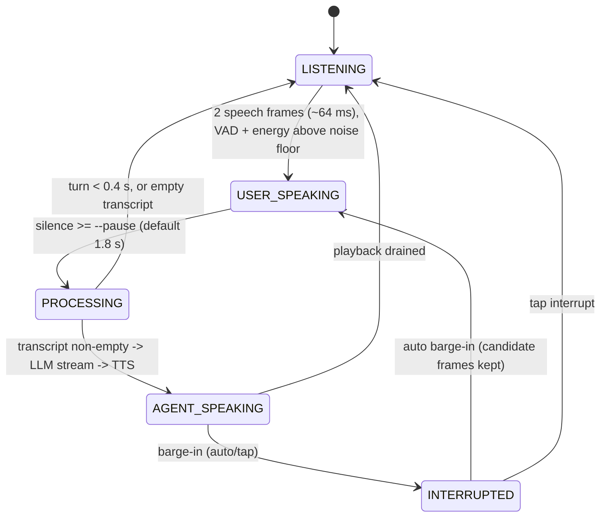

# Live Session Interaction Flow (current behavior, documented only)

Source: `src/audio_agent/audio/live_session.py`. No behavior was changed by this document.

## Known gaps (inputs for the control-flow redesign)
- Audio arriving while `PROCESSING` is not buffered as a new turn (the state ignores it).
- A turn shorter than 0.4 s is discarded without feedback.
- An empty transcript silently returns to `LISTENING`.
- `--barge-in tap|off` ignores the microphone entirely while the agent speaks.
- Every non-empty transcript triggers a reply; there is no "should I respond?" decision step.
- No `0`/`Y` control convention exists in the code. It needs a definition before any change.

