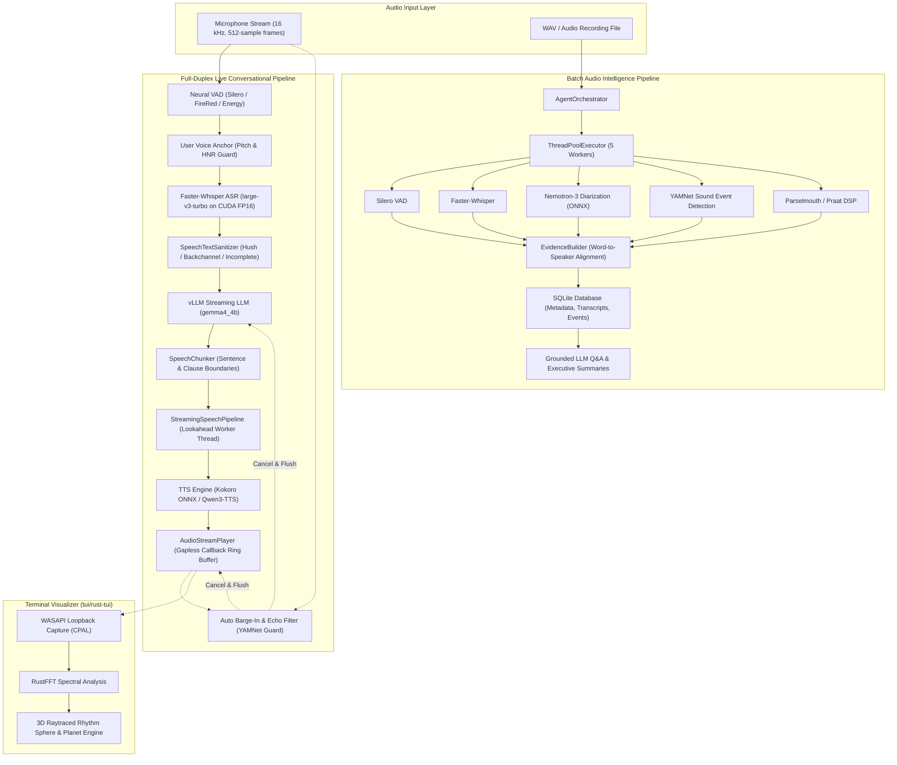
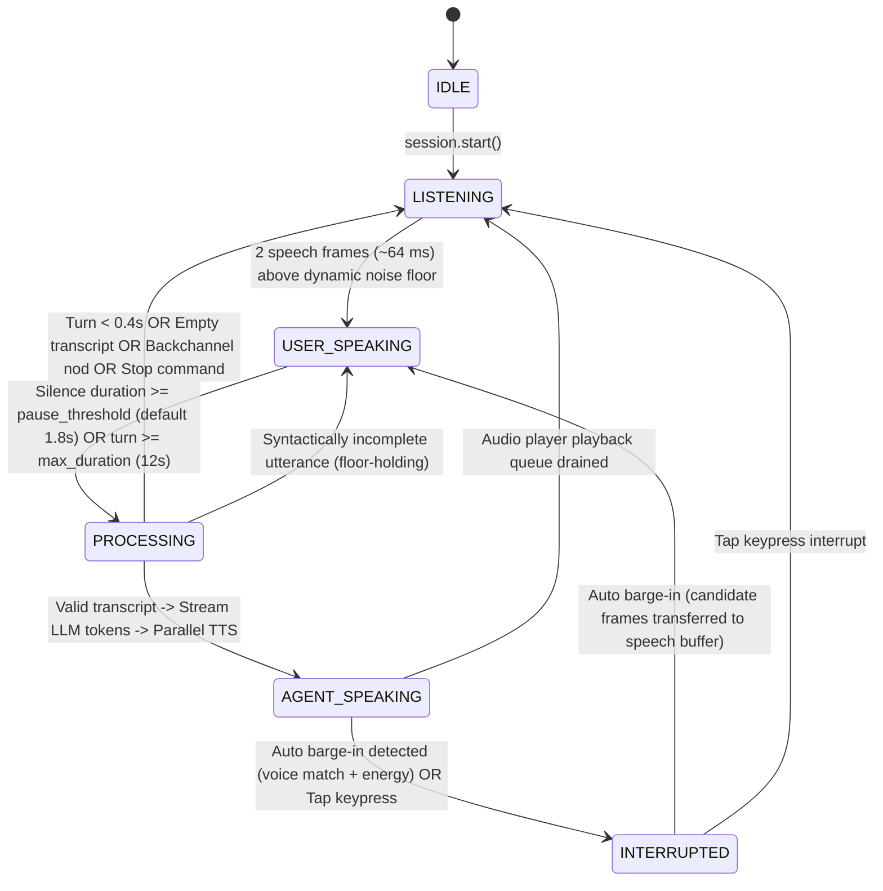
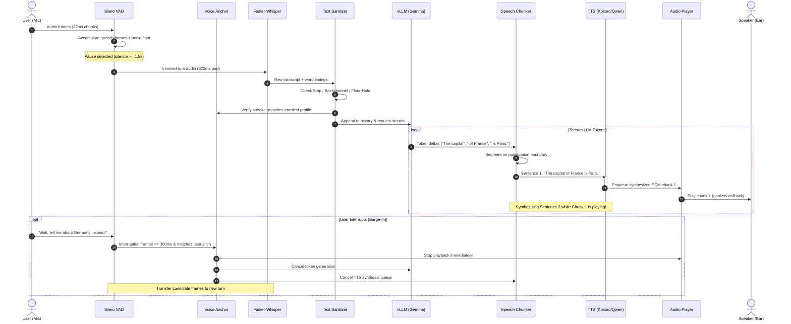
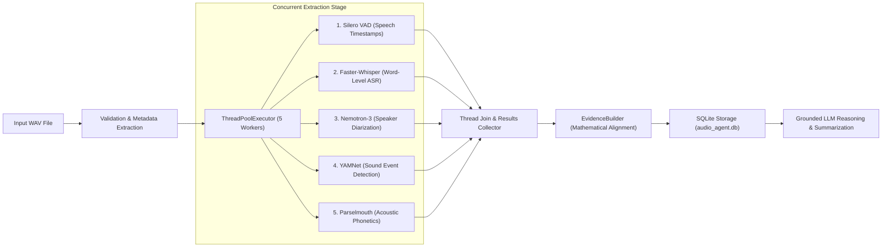

# Local-First Audio Intelligence Agent — Pipeline Architecture & Integration Guide

## 1. Executive Architecture Overview

The system is designed with a **dual-pipeline local-first architecture**:
1. **Full-Duplex Real-Time Conversational Voice Pipeline (`live_session.py`):** Hands-free, low-latency voice interaction with streaming neural VAD, noise-gated pause endpointing, voice profile anchoring, fast ASR, streaming LLM token generation, sentence-level speech chunking, parallel TTS synthesis, gapless audio streaming, and auto barge-in interruption.
2. **Deep Offline / Batch Audio Intelligence Pipeline (`orchestrator.py`):** Comprehensive multi-modal audio analysis executing VAD, word-level ASR, speaker diarization, acoustic phonetics ($F_0$, jitter, shimmer, HNR), and sound event detection (SED) concurrently in a thread pool, mathematically aligning evidence into an SQLite database for grounded LLM reasoning and question answering.



---

## 2. Full-Duplex Conversational Voice Pipeline

The live conversational system is implemented in [`src/audio_agent/audio/live_session.py`](file:///c:/Users/verge/SourceMaker/AudioAgent/src/audio_agent/audio/live_session.py) and coordinates audio capture, intelligence filters, reasoning, and synthesis.

### 2.1 State Machine & Turn-Taking Logic

The session operates as a deterministic finite-state machine with 6 core states:



### 2.2 Step-by-Step Interaction Lifecycle

#### 1. Microphone Streaming & Dynamic Noise Gating
- Microphone frames arrive at **16 kHz mono `float32`** in 512-sample (32 ms) blocks via `sounddevice.InputStream`.
- **Adaptive Ambient Noise Tracking:** Non-speech frames continuously adjust an exponential moving average (`_noise_floor_rms = 0.95 * floor + 0.05 * frame_rms`).
- **Speech Gate:** Speech is recognized only when **both** conditions are satisfied:
  $$\text{prob} \ge \text{vad\_threshold (0.55)} \quad \text{AND} \quad \text{frame\_rms} \ge \max(0.009, 2.0 \times \text{noise\_floor\_rms})$$
- Requires 2 consecutive speech frames (~64 ms) to transition from `LISTENING` to `USER_SPEAKING`, preventing room clicks or coughs from tripping the trigger.

#### 2. Pause Endpointing with Tail Trimming
- During `USER_SPEAKING`, accumulated silence frames are counted.
- Two consecutive speech frames are required to reset the silence counter, preventing background room blips from extending the turn indefinitely.
- When silence reaches `pause_threshold` (default 1.8s, configurable to 1.2s–2.5s) or total turn reaches `max_turn_duration_seconds` (default 12.0s):
  - Trailing silence is trimmed back to **320 ms of padding**, eliminating trailing noise that causes Whisper to hallucinate repetitions.
  - The utterance is dispatched asynchronously to a worker thread for processing.

#### 3. Conversational Intelligence & Sanitization Gate
Before prompting the LLM, the raw user transcript passes through four intelligence checks in [`SpeechTextSanitizer`](file:///c:/Users/verge/SourceMaker/AudioAgent/src/audio_agent/audio/sanitizer.py) and [`UserVoiceAnchor`](file:///c:/Users/verge/SourceMaker/AudioAgent/src/audio_agent/audio/voice_anchor.py):
1. **Explicit Hush / Stop Commands:** Phrases like *"stop talking"*, *"be quiet"*, or *"stop and listen"* immediately cut off playback, clear context, and return to `LISTENING`.
2. **Passive Backchannel Filter:** Conversational nods (*"okay"*, *"uh-huh"*, *"yeah"*, *"mhm"*, *"got it"*) are recognized as listening acknowledgements; the agent remains quiet and attentive instead of generating an unneeded response.
3. **Voice Profile Anchoring:**
   - In **Personal Mode**, the first clean utterance anchors the user's fundamental pitch ($F_0$) and harmonicity (HNR) using Praat/Parselmouth.
   - Subsequent speech from background room voices or ambient chatter that does not match the enrolled profile is rejected.
4. **Floor-Holding / Incomplete Thought Detection:**
   - If the transcript ends in coordinating conjunctions, prepositions, or incomplete clauses (e.g. *"how do you make a pizza in..."*), the agent holds the floor (`on_floor_held`), stores the audio chunk, and transitions back to `USER_SPEAKING` to let the user finish their sentence.

#### 4. Streaming Token Generation & Speech Pipeline Handshake
- Clean user input is appended to the rolling conversational history (`messages`).
- The system prompt instructs the LLM to output concise, natural conversational sentences (1–3 sentences), while automatically correcting phonetic misunderstandings.
- The LLM stream begins yielding tokens via `vLLM` HTTP streaming.
- Tokens are pushed into [`StreamingSpeechPipeline`](file:///c:/Users/verge/SourceMaker/AudioAgent/src/audio_agent/audio/speech_pipeline.py) via `push_text(token)`.

#### 5. Lookahead Chunking & Parallel TTS Synthesis
- **[`SpeechChunker`](file:///c:/Users/verge/SourceMaker/AudioAgent/src/audio_agent/audio/speech_chunker.py):** Buffers incoming token deltas until a natural linguistic boundary is reached:
  - Sentence boundaries: `.`, `!`, `?`, `…`, `\n`
  - Clause boundaries (if word count exceeds threshold): `,`, `;`, `:`, `—`
  - Stall flush (`max_wait_s`): Forces out buffered words if the LLM stalls mid-sentence.
- **Asynchronous Worker Thread:** Synthesizes sentence chunk $N+1$ via Kokoro-TTS or Qwen3-TTS on a background worker thread **while sentence chunk $N$ is actively playing through the soundcard**.
- **`AudioStreamPlayer`:** Maintains a non-blocking `sounddevice.RawOutputStream` ring buffer with seamless crossfading, ensuring gapless voice playback without token starvation.

#### 6. Hands-Free Full-Duplex Auto Barge-In
- While the agent speaks (`AGENT_SPEAKING`), the microphone remains hot.
- **Acoustic Bleed Floor Tracking:** Tracks speaker echo leaking into the microphone only during user silence.
- **Interruption Gate:** An interruption requires:
  $$\text{prob} \ge \text{interruption\_vad\_threshold (0.60)} \quad \text{AND} \quad \text{frame\_rms} \ge \max(0.010, 1.15 \times \text{bleed\_floor})$$
  held continuously for $\ge \text{min\_interruption\_duration}$ (default 300 ms).
- **Anti-Echo & Non-Speech Event Guard:**
  - Evaluates candidate audio against the synthetic agent pitch to avoid self-interruption.
  - Passes candidate audio through YAMNet to reject coughs, laughter, snickers, and sneezes.
- When valid barge-in speech occurs:
  1. The player stops immediately.
  2. The LLM streaming event is canceled.
  3. The TTS worker queue is drained.
  4. Candidate interruption frames are preserved and transferred to the new user speech buffer, so the first words of the user's interruption are not lost.

---

## 3. End-to-End Sequence Diagram (Live Session)



---

## 4. Batch Audio Intelligence Pipeline

The batch analysis pipeline is orchestrated by [`AgentOrchestrator`](file:///c:/Users/verge/SourceMaker/AudioAgent/src/audio_agent/orchestrator.py) and is invoked via `audio-agent analyze <file.wav>` or programmatic API calls.



### 4.1 Concurrent Extraction Components

| Capability | Model / Engine | Hardware / Execution | Output Schema | Key Parameters |
|---|---|---|---|---|
| **VAD** | Silero VAD v5 | CPU (ONNX Runtime) | `List[VADRegion]` | `threshold: 0.55`, `min_speech_duration_ms: 250` |
| **ASR** | Faster-Whisper (`large-v3-turbo`) | CUDA FP16 (RTX 4060) | `str` transcript, `List[WordTimestamp]` | `beam_size: 1`, `compute_type: float16` |
| **Diarization** | Nemotron-3 Diarization | CUDA (ONNX Runtime) | `List[SpeakerSegment]` | `threshold: 0.35`, 264-frame FIFO cache |
| **Sound Events** | YAMNet (MobileNet V1) | CUDA / CPU (ONNX Runtime) | `List[SoundEvent]` (AudioSet top 5) | `score_threshold: 0.15`, `top_k: 5` |
| **Acoustic DSP** | Praat / Parselmouth | CPU (Host C-bindings) | `AcousticFeatures` | $F_0$ (75–600 Hz), jitter, shimmer, HNR |

### 4.2 Word-Level Mathematical Alignment (`EvidenceBuilder`)

Because speech recognition and speaker diarization run independently, word timestamps and speaker turns must be aligned post-hoc:
- For every transcribed word $[t_{\text{start}}, t_{\text{end}}]$, the overlap duration with each speaker segment $[s_{\text{start}}, s_{\text{end}}]$ is computed:
  $$\text{Overlap}(w, s) = \max\left(0, \min(t_{\text{end}}, s_{\text{end}}) - \max(t_{\text{start}}, s_{\text{start}})\right)$$
- The word is assigned to the speaker with the maximum temporal overlap.
- If a word falls in a diarization gap, it inherits the nearest active speaker turn within a 200 ms tolerance window.
- The resulting unified `AnalysisEvidence` payload combines words, speakers, sound events, and voice quality metrics into a single structured timeline.

### 4.3 SQLite Storage Schema & Retention

All evidence is saved to `data/database/audio_agent.db` managed by [`DatabaseManager`](file:///c:/Users/verge/SourceMaker/AudioAgent/src/audio_agent/storage/database.py):
- `recordings`: ID, file path, duration, file size, retention flags, creation timestamp.
- `analyses`: Raw JSON serialization of `AnalysisEvidence` (speech segments, acoustic features, sound events, executive summaries).
- `speaker_aliases`: Human-friendly name mappings (e.g. `speaker_1` $\to$ `"Alice"`).
- **Privacy Policy:** Strictly adheres to `config/privacy.yaml` (local-only storage, zero cloud telemetry, optional audio file deletion with `--keep-audio` flags).

---

## 5. Terminal User Interface (TUI) & Visualizer Integration

The repository includes both Python Textual interfaces and a high-performance Rust terminal visualizer:

### 5.1 Architecture of `tui/rust-tui`
The Rust visualizer ([`tui/rust-tui/`](file:///c:/Users/verge/SourceMaker/AudioAgent/tui/rust-tui)) runs a native 60 FPS audio visualizer using standard library Rust, `cpal` (WASAPI loopback capture), `rustfft`, and raw ANSI escape sequences:

- **Audio Loopback Capture (`audio.rs`):** Intercepts system audio output on Windows via WASAPI loopback without requiring microphone routing.
- **FFT Spectral & Loudness Analysis:** 512-sample FFT, Hanning windowing, and 16 logarithmic frequency bands matching the Python agent's band edges.
- **Dual Visualizer Modes (`planet.rs`):**
  1. **`sphere (rhythm)`:** Raytraced 3D rhythm sphere. Audio frequency bands modulate surface latitudes; drum kicks spawn expanding shockwave rings; surface wave equations ripple with rotation; specular lighting creates 3D depth. Supports 5 glyph ramps (Classic ASCII, Smooth Ramp, Braille, Blocks, Dots).
  2. **`planet (grains)`:** Braille grain cloud with frequency-driven particle displacement and aspect-ratio correction (preventing vertical egg distortion).
- **Benchmark Performance:** Renders frames in **~0.23 ms** in release mode, leaving >98% of the frame budget free.

---

## 6. Configuration & Model Parameter Reference

The agent's configuration is managed via three YAML files in `config/`:

### `config/models.yaml`
```yaml
asr:
  provider: "faster_whisper"
  model: "large-v3-turbo"       # 685ms execution on RTX 4060 GPU
  device: "cuda"
  compute_type: "float16"
  beam_size: 1

vad:
  enabled: true
  provider: "silero"            # options: silero, firered, energy, none
  model: "silero-vad"
  device: "cpu"
  threshold: 0.55               # 0.55-0.65 rejects room background voices

diarization:
  provider: "nemotron"
  model: "Nemotron-3-Diarization-ONNX"
  device: "cuda"
  threshold: 0.35

sound_events:
  provider: "yamnet"
  model: "yamnet"
  device: "cuda"
  top_k: 5
  score_threshold: 0.15

acoustic:
  provider: "parselmouth"
  pitch_floor_hz: 75.0
  pitch_ceiling_hz: 600.0

llm:
  provider: "vllm"
  model: "gemma4_4b"
  endpoint: "http://192.168.1.11:8001/v1"
  temperature: 0.5
  max_tokens: 384

tts:
  provider: "kokoro"            # options: kokoro (local ONNX), qwen (remote vLLM)
  voice: "af_sarah"             # options: af_sarah, af_bella, am_adam, am_michael
  speed: 1.0
  device: "cuda"
```

---

## 7. Command Quick Reference

| Command | Description |
|---|---|
| `uv run audio-agent doctor` | Validates GPU CUDA status, audio hardware, and provider availability. |
| `uv run audio-agent live` | Launches the full-duplex hands-free live voice conversation session. |
| `uv run audio-agent live --tui` | Launches live session embedded inside the Textual live visualizer. |
| `uv run audio-agent live --barge-in tap` | Sets barge-in to tap mode (<kbd>Enter</kbd> / <kbd>Space</kbd> / <kbd>i</kbd> to interrupt). |
| `uv run audio-agent live --mode meeting` | Sets mode to Meeting / Collaborative (disables single-user voice anchor). |
| `uv run audio-agent analyze <file.wav>` | Runs the offline multi-modal batch extraction pipeline. |
| `uv run audio-agent ask <rec_id> "question"` | Queries stored recording evidence with grounded LLM answers. |
| `uv run audio-agent chat <rec_id>` | Interactive terminal chat session grounded in an analyzed recording. |
| `uv run audio-agent recordings list` | Displays all analyzed audio sessions stored in SQLite. |
| `uv run audio-agent recordings alias <id> <spk> <name>` | Renames an anonymous speaker ID to a human alias. |
| `uv run audio-agent devices` | Lists all audio input devices and their indices. |

